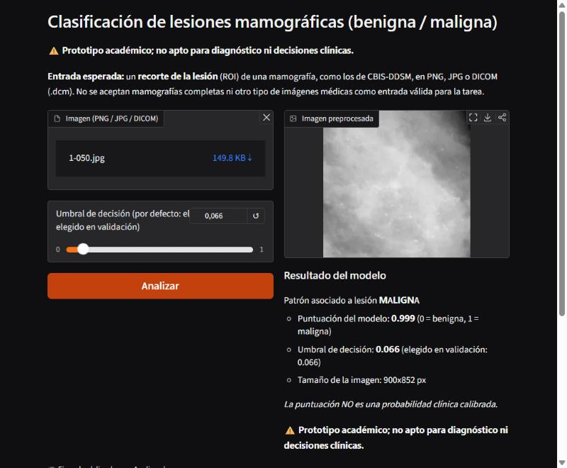
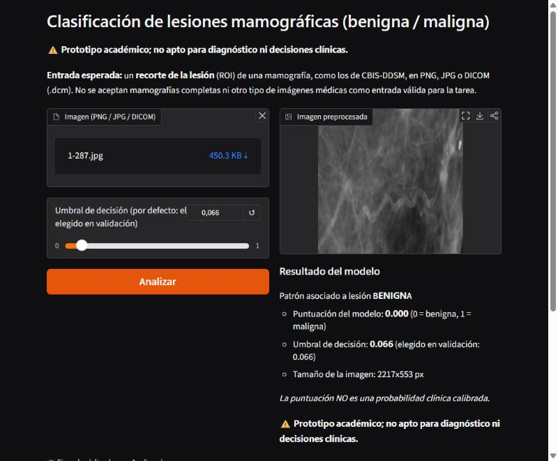
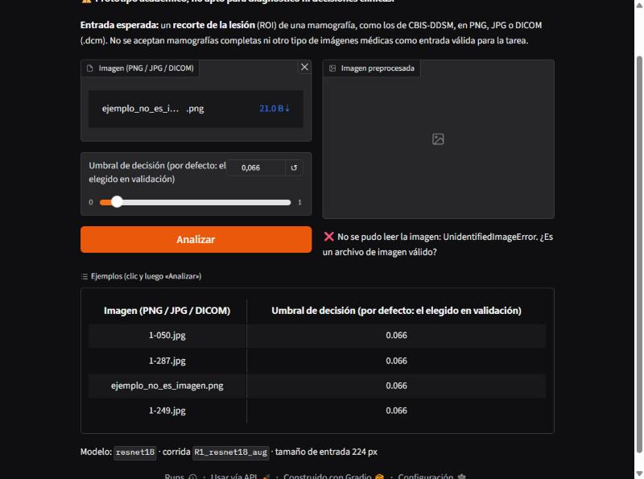
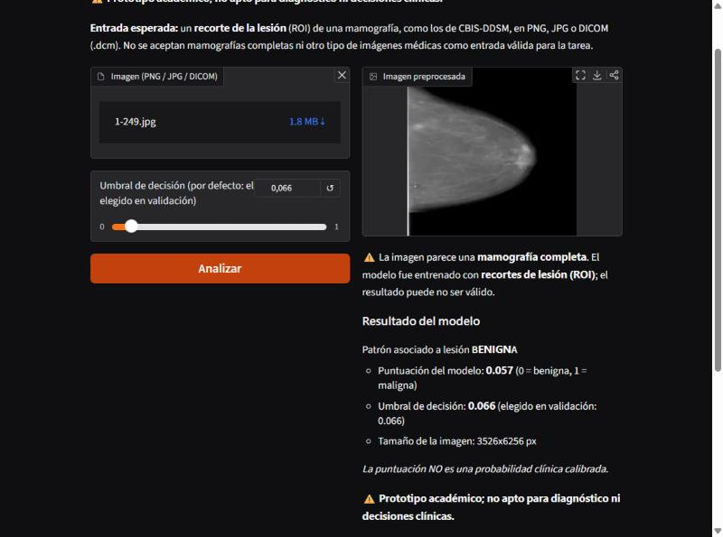

# Clasificación de lesiones mamográficas benignas y malignas mediante aprendizaje profundo
Grupo 8 — José Gil Soto Méndez, Andrés Alfonso Luna Moreno, Miguel Francisco Guerra Negrete
Aprendizaje Computacional – Ingeniería de Sistemas · Noviembre 2026

> **Aviso:** prototipo académico; no apto para diagnóstico ni decisiones clínicas.

<!--
REGLAS DEL INFORME (borrar este comentario en la versión final)
- Máximo 10 páginas sin anexos.
- Cada sección indica quién la redacta. Cada uno escribe la suya con sus palabras; antes de editar: git pull; al terminar: commit + push.
- Ninguna cifra se escribe a mano: todo sale de runs/ y reports/. Lo que falte queda como <<PENDIENTE: ...>>.
-->

## 1. Comprensión del problema  *(redacta: José)*

El objetivo es construir un prototipo que, dado el **recorte de una lesión** ya localizada en una mamografía, estime si su patología de referencia es benigna o maligna. El usuario previsto es académico: sirve para estudiar cómo se comporta un clasificador de imágenes médicas y qué decisiones lo vuelven confiable o engañoso. No es una herramienta clínica y no se diseñó para serlo.

**Unidad de análisis: la lesión.** Cada fila de los CSV de CBIS-DDSM describe una lesión vista en una proyección (CC o MLO), con su recorte (ROI) y su patología verificada. Trabajar con la imagen completa obligaría al modelo a encontrar la lesión además de clasificarla, y con los datos que tenemos eso es otro proyecto. Trabajar por mama o por examen mezclaría varias lesiones con etiquetas distintas. La lesión es la unidad donde la etiqueta tiene un significado claro.

**Qué significa la etiqueta.** La columna `pathology` dice si la lesión resultó benigna o maligna según la verificación del DDSM. Eso es la patología de **una lesión ya anotada**, no el diagnóstico de la paciente: una paciente puede tener una lesión benigna en un recorte y cáncer en otro lugar que nadie marcó. El mapeo completo está en `docs/tabla_etiquetas.md`.

**Costo de los errores.** Un falso negativo es una lesión maligna que el sistema llama benigna: en un uso real retrasaría un diagnóstico, y eso puede costar tratamiento y pronóstico. Un falso positivo es una lesión benigna llamada maligna: cuesta un estudio adicional, una biopsia y angustia, pero se corrige. Como no pesan lo mismo, el umbral de decisión no se deja en 0,5 por defecto: se elige en validación como el más alto que alcanza **sensibilidad para malignas ≥ 0,90**, aceptando más falsos positivos a cambio.

**Hipótesis (escritas el 2026-11-18, antes de entrenar; ver `docs/hipotesis.md`).**
- **H1:** con ResNet18 preentrenada, activar los aumentos (R1) frente a no activarlos (R2) reduce la brecha entre pérdida de validación y de entrenamiento y sube el ROC-AUC de validación en al menos 0,02.
- **H2:** el umbral elegido para sensibilidad ≥ 0,90 queda por debajo de 0,5, baja la especificidad de validación al rango 0,35–0,60 y, en prueba, la sensibilidad queda entre 0,80 y 0,90.

**Limitaciones de partida.** Mamografías de película escaneada de los años 90 (no digitales actuales), una población estadounidense, casos seleccionados porque tenían lesiones, y un tamaño de muestra de unos pocos miles de recortes. Todo lo que concluyamos vale para este conjunto, no para una paciente colombiana en 2026.

## 2. Datos  *(redacta: Andrés)*
**Fuente.** CBIS-DDSM (*Curated Breast Imaging Subset of DDSM*), publicado en The Cancer Imaging Archive con licencia **CC BY 3.0** (DOI 10.7937/K9/TCIA.2016.7O02S9CY). Usamos la copia en JPEG de Kaggle (`awsaf49/cbis-ddsm-breast-cancer-image-dataset`), que conserva los CSV oficiales con la patología de cada lesión. Son mamografías de película escaneada, de hospitales de Estados Unidos y de los años noventa. La etiqueta sale de la verificación patológica del DDSM, no de una lectura BI-RADS.

**Cantidades.** Los cuatro CSV (masas y calcificaciones, entrenamiento y prueba oficiales) describen 3.568 lesiones. De ellas, 3.566 tienen su recorte; las otras 2 se descartaron porque la imagen recortada no se encontró (`descartadas.csv`), y no hubo archivos idénticos (MD5). Quedan **3.566 lesiones de 1.566 pacientes**: 2,3 lesiones por paciente en promedio y hasta 24 en una misma paciente. Son 1.870 calcificaciones y 1.696 masas, 1.894 en vista MLO y 1.672 en CC (`data/splits/resumen.json`, `reports/eda/eda_resumen.json`). Cada fila es una lesión **en una vista**: la misma lesión vista en CC y en MLO cuenta dos veces.

| Etiqueta original (`pathology`) | Etiqueta del proyecto | Lesiones |
|---|---|---|
| `MALIGNANT` | maligna (1) | 1.456 |
| `BENIGN` | benigna (0) | 1.429 |
| `BENIGN_WITHOUT_CALLBACK` | benigna (0) | 681 |

El 40,8 % de las lesiones es maligno. `BENIGN_WITHOUT_CALLBACK` (BWC) es el 19 % del total; la decisión de contarla como benigna y sus alternativas están en `docs/tabla_etiquetas.md`.

**Análisis exploratorio.**
- `reports/eda/balance_clases.png`: las tres particiones tienen una proporción parecida de malignas (40,9 %, 42,6 % y 38,6 %). Las clases están algo desbalanceadas (6 benignas por cada 4 malignas), pero no tanto como para tener que remuestrear.
- `reports/eda/tipo_vs_clase.png`: los dos tipos no se reparten igual. Las masas son 46 % malignas (784 de 1.696) y las calcificaciones 36 % (672 de 1.870). Además, 540 de las 681 BWC (79 %) son calcificaciones: casi todas las benignas "obvias" están en ese tipo.
- `reports/eda/tamanos.png`: los recortes van de 68 a 2.893 píxeles de ancho (mediana 340 × 337). Todos se llevan a 224 × 224, así que los grandes se reducen más de 10 veces y pierden detalle fino, lo que afecta sobre todo a las calcificaciones. En la figura, la mayoría de los recortes más grandes son malignos: el tamaño del recorte va algo ligado a la clase.
- No hubo imágenes ilegibles (`imagenes_ilegibles: 0`).

**Sesgos posibles.** Película escaneada y no mamografía digital; una población y una época concretas; casos que entraron al conjunto porque tenían una lesión (el modelo nunca vio una mamografía normal); calidad de escaneo variable; y la mezcla desigual de tipos y de BWC descrita arriba, que puede hacer que el modelo aprenda atajos del tipo de lesión en vez de la patología.

## 3. Preparación  *(redacta: Andrés)*
1. **Lectura y etiquetas.** Se unen los cuatro CSV y `pathology` se traduce a 0/1 con `LABEL_MAP` (`src/prepare_data.py`).
2. **Limpieza.** Cada recorte se ubica con `dicom_info.csv` usando la serie marcada como *cropped* (el recorte, no la máscara). Se descartan las lesiones sin imagen y los archivos idénticos por MD5.
3. **Partición por paciente.** `StratifiedGroupKFold` con semilla 42 agrupa por `patient_id`, para que todas las lesiones de una paciente caigan en la misma partición, y estratifica por etiqueta. Resultado: 2.527 lesiones de entrenamiento (1.115 pacientes), 521 de validación (225) y 518 de prueba (226), con 40,9 %, 42,6 % y 38,6 % de malignas. El código no da 70/15/15 exacto: separa la prueba como 1 de 7 grupos y la validación como 1 de 6 de lo que queda (≈71/15/15). Salida de `src/check_leakage.py` sobre `data/splits/lesiones.csv`: **0 pacientes** en más de una partición (las tres intersecciones dan 0), 0 imágenes idénticas en particiones distintas, "SIN FUGA". Partir por paciente importa porque cada lesión aparece en dos vistas (CC y MLO): si se partiera por fila, una vista podría quedar en entrenamiento y la otra en prueba, y el modelo se evaluaría con una lesión que ya vio.
4. **Transformación.** La imagen se lee en escala de grises y se copia a 3 canales, se redimensiona a 224 × 224 y se normaliza con la media y la desviación de ImageNet, que es la escala que esperan los pesos preentrenados de ResNet18.
5. **Aumentos (solo entrenamiento).** Volteo horizontal y vertical, rotación de hasta ±10° y brillo/contraste ±10 %. Son razonables porque no cambian la patología: una lesión volteada, algo girada o un poco más clara sigue siendo la misma lesión, y una mama izquierda volteada se parece a una derecha. Se dejaron suaves a propósito: rotaciones grandes o cambios fuertes de contraste podrían borrar las calcificaciones finas. Validación y prueba no se alteran.

## 4. Modelado  *(redacta: José)*

Se entrenaron tres corridas con la misma partición, semilla 42, pérdida `BCEWithLogitsLoss`, optimizador AdamW (weight decay 1e-4), tasa de aprendizaje con decaimiento coseno, lotes de 32, imágenes de 224 px y parada temprana con paciencia 5 según el ROC-AUC de validación (se guardan los pesos de la mejor época).

| Corrida | Modelo | Preentrenado | Aumentos | lr | Épocas máx. (mejor) | Batch | Optimizador | Semilla | Tiempo |
|---|---|---|---|---|---|---|---|---|---|
| R0 | CNN pequeña (4 bloques conv, 98.049 parámetros) | no | sí | 1e-3 | 25 (5; parada en 10) | 32 | AdamW | 42 | 3,7 min |
| R1 | ResNet18 (11.177.025 parámetros) | ImageNet | sí | 1e-4 | 15 (12) | 32 | AdamW | 42 | 5,8 min |
| R2 | ResNet18 | ImageNet | **no** | 1e-4 | 15 (1; parada en 6) | 32 | AdamW | 42 | 1,9 min |

**R0 como línea base.** Una red pequeña entrenada desde cero marca el piso: si la transferencia de aprendizaje no la supera con claridad, algo anda mal en el pipeline o los datos no alcanzan.

**Experimento controlado (R1 vs R2).** La única decisión que cambia es la bandera `--aug`. Todo lo demás (modelo, pesos iniciales, datos, semilla, lr, épocas, batch) se mantiene, así que cualquier diferencia se puede atribuir a los aumentos y no a una mezcla de cambios. Lo esperado está en H1.

**Hardware.** Google Colab con GPU Tesla T4 (15 GB), PyTorch 2.14.1+cu130, Python 3.13; ~22 s por época. Las tres corridas usan el código del commit `a73c475` (registrado en cada `config.json`).

**Lo que se vio al entrenar.** R0 fue inestable con lr = 1e-3: en la época 8 su AUC de validación cayó a 0,47 y a 0,5 llamó benignas a todas las lesiones; la parada temprana conservó la época 5 (0,694). R2, sin aumentos, bajó la pérdida de entrenamiento de 0,595 a 0,028 en seis épocas mientras la de validación subía de 0,567 a 0,906: memorizó. R1 bajó más despacio (0,24 en la época 15) y su mejor AUC llegó en la época 12.

## 5. Evaluación  *(redacta: José, salvo 5.5 que redacta Miguel)*

### 5.1 Umbral
El umbral se elige **solo en validación**: el más alto que logra sensibilidad maligna ≥ 0,90 (`evaluate.py --strategy sens --target-sens 0.90`) y se guarda en `threshold.json`. La salida del modelo es una **puntuación** (sigmoide de un logit), no una probabilidad calibrada: un 0,7 no significa "70 % de probabilidad de cáncer", solo que el modelo la ordena por encima de un 0,6. Por eso el umbral se fija mirando el compromiso sensibilidad/especificidad y no leyendo la puntuación como riesgo.

Para R1 el umbral quedó en **0,066**. Que el corte esté tan lejos de 0,5 confirma lo anterior: las puntuaciones de R1 se amontonan cerca de 0 y no se pueden leer como probabilidad.

### 5.2 Comparación en validación
Validación: 521 lesiones (222 malignas, 299 benignas) de 225 pacientes. Cada corrida con su propio umbral para sensibilidad ≥ 0,90 (`reports/comparacion_val.md`):

| Corrida | ROC-AUC | Umbral | Sensibilidad | Especificidad | Precisión | F1 | FN | FP |
|---|---|---|---|---|---|---|---|---|
| R0 CNN pequeña | 0,694 | 0,378 | 0,905 | 0,361 | 0,513 | 0,655 | 21 | 191 |
| **R1 ResNet18 + aumentos** | **0,819** | 0,066 | 0,901 | **0,518** | **0,581** | **0,707** | 22 | **144** |
| R2 ResNet18 sin aumentos | 0,782 | 0,156 | 0,901 | 0,418 | 0,535 | 0,671 | 22 | 174 |

**Ganador: R1.** Tiene el mayor ROC-AUC y, con la misma sensibilidad que las otras dos (≈ 0,90, unos 22 cánceres sin marcar de 222), es la que menos falsas alarmas da: 144 benignas marcadas frente a 174 de R2 y 191 de R0. La transferencia de aprendizaje le gana a la red desde cero por 0,125 de AUC; los aumentos suman 0,037 más. La elección se hizo solo con validación; la prueba no se ha mirado.

### 5.3 Resultado final en prueba (una sola vez)
Se ejecutó **una sola vez** (`registro_uso_test.txt`: `2026-11-18 11:53:02 umbral=0.0664 metodo=sens (objetivo sens=0.9)`), con R1 y el umbral 0,066 fijados en validación. Prueba: 518 lesiones (200 malignas, 318 benignas) de 226 pacientes que el modelo nunca vio.

| | Predice benigna | Predice maligna |
|---|---|---|
| **Es benigna** (318) | VN = 146 | FP = 172 |
| **Es maligna** (200) | FN = 22 | VP = 178 |

| Sensibilidad maligna | Especificidad | Precisión | F1 | ROC-AUC | Exactitud |
|---|---|---|---|---|---|
| 0,890 | 0,459 | 0,509 | 0,647 | 0,788 | 0,625 |

En palabras: de cada 100 lesiones malignas, el modelo deja pasar 11 como benignas; a cambio, marca como sospechosas a más de la mitad de las benignas (172 de 318). Todo bajó un poco respecto a validación (AUC 0,819 → 0,788; sensibilidad 0,901 → 0,890; especificidad 0,518 → 0,459), que es lo esperable cuando modelo y umbral se eligieron mirando validación.

**Efecto del umbral (validación, R1, `tabla_umbrales.csv`).** A 0,5 el modelo solo atrapa 0,604 de las malignas (88 FN) con especificidad 0,853; a 0,2, 0,802 (44 FN) con 0,696; al umbral elegido (0,066), 0,901 (22 FN) con 0,518. Bajar de 0,2 a 0,066 atrapa 22 cánceres más a cambio de 53 falsas alarmas más: unas 2,4 por cada cáncer rescatado. Es el precio que aceptamos para que un FN sea raro.

**Curvas y sobreajuste (`curvas.png`, `log.csv`).** R2 es el caso de libro: la pérdida de entrenamiento cae a 0,028 mientras la de validación sube a 0,906, y su mejor AUC fue en la primera época. R1 sobreajusta más despacio: la brecha crece de 0,11 (época 6) a 0,35 (época 12), pero el AUC de validación sigue mejorando hasta la época 12.

**¿Se confirmaron las hipótesis?** H1, parcialmente: los aumentos subieron el AUC (+0,037) y retrasaron la mejor época (12 vs 1), pero la forma en que medimos el sobreajuste (brecha en la mejor época de cada modelo) no lo mostró. Comparando a igual época, el efecto es claro. H2, sí: el umbral quedó muy por debajo de 0,5 (0,066), la especificidad bajó a 0,518 en validación y la sensibilidad en prueba fue 0,890, dentro del rango 0,80–0,90 predicho.

### 5.4 Indicaciones de la revisión del día 7: más épocas, más datos e imágenes nuevas

En la revisión el profesor pidió entrenar más, con más datos, y probar el modelo final con imágenes que nunca hubiera visto. Se hicieron tres corridas más con el código del commit `56148a4` (24-nov):

| Corrida | Qué cambia | Datos de entrenamiento | Épocas (mejor) | ROC-AUC val | Umbral (val) | Especificidad (val) | FP (val) |
|---|---|---|---|---|---|---|---|
| R1 | referencia | 2.527 | 15 (12) | **0,819** | 0,066 | **0,518** | **144** |
| R3 | más épocas: hasta 30, paciencia 7 | 2.527 | 30 (10; paró en 17) | 0,812 | 0,068 | 0,498 | 150 |
| R4 | más datos: train + val | **3.048** (+21 %) | 10, fijadas con R3 | (no aplica: val está dentro) | 0,068, tomado de R3 | — | — |

**Más épocas no mejoró.** R3 alcanzó su mejor AUC en la época 10 (0,812) y después sobreajustó: la pérdida de validación subió de 0,59 a 0,87 mientras la de entrenamiento seguía bajando. R1 ya estaba cerca de su techo con 15 épocas.

**Prueba externa con mini-MIAS.** mini-MIAS (Reino Unido) es otro escáner, otra población y otra resolución (200 µm por píxel). De sus 330 anotaciones se descartaron 207 mamografías normales y 4 anomalías sin coordenadas, y quedaron **119 lesiones de 104 pacientes (51 malignas, 68 benignas; 92 masas y 27 calcificaciones)**. Cada lesión se recortó con el centro y el radio del archivo `Info.txt` (`src/prepare_mias.py`). Ningún modelo vio estas imágenes; el umbral es el fijado en validación de CBIS-DDSM, sin reajustar nada con MIAS (`src/evaluate_external.py`, `registro_uso_externo.txt`).

| Modelo | ROC-AUC MIAS | Sensibilidad | Especificidad | FN | FP |
|---|---|---|---|---|---|
| R1 | 0,710 | 1,000 | 0,029 | 0 | 66 |
| R3 | 0,725 | 1,000 | 0,015 | 0 | 67 |
| R4 (train+val) | 0,714 | 1,000 | 0,015 | 0 | 67 |

**Lectura.** El modelo conserva parte de su capacidad de ordenar (AUC 0,71–0,73 frente a 0,788 en la prueba de CBIS-DDSM), pero sus puntuaciones se desplazan hacia arriba con el nuevo escáner: con el umbral de CBIS-DDSM marca casi todas las lesiones como malignas, e incluso a 0,5 R1 marca 51 de las 68 benignas (especificidad 0,25, tabla de exploración, no usada para elegir nada). Ni más épocas ni más datos del mismo dominio lo corrigen: el problema es el **cambio de dominio**, no la cantidad de datos. Para usar el modelo con otro equipo habría que recalibrar el umbral con un conjunto de calibración de ese equipo, separado del que se use para evaluar.

### 5.5 Análisis de errores  *(redacta: Miguel)*
**Método (fijado antes de revisar los casos):** en validación se toman los falsos negativos de puntuación más baja y los falsos positivos de puntuación más alta, mínimo 4 de cada uno, y se mide la tasa de error por tipo de lesión, `subtlety` y `assessment` (`docs/analisis_errores.md`, `src/errores_por_grupo.py`).

**Resultados (R1 en validación, umbral 0,066):** 22 falsos negativos de 222 malignas (de 17 pacientes) y 144 falsos positivos de 299 benignas.

| Grupo | Lesiones | Malignas | FN | FP | % de malignas que se escapan | % de benignas marcadas malignas |
|---|---|---|---|---|---|---|
| Calcificaciones | 273 | 107 | 14 | 69 | 13,1 | 41,6 |
| Masas | 248 | 115 | 8 | 75 | 7,0 | 56,4 |
| `assessment` 2 | 99 | 0 | 0 | 28 | — | 28,3 |
| `assessment` 4 | 257 | 125 | 16 | 80 | 12,8 | 60,6 |
| `subtlety` 1–2 | 89 | 50 | 4 | 28 | 8,0 | 71,8 |
| `subtlety` 4–5 | 273 | 105 | 9 | 74 | 8,6 | 44,0 |

**Casos** (los 4 primeros de cada lista; tabla completa con hipótesis en `docs/analisis_errores.md`):

| Error | `lesion_uid` | Puntuación | Tipo | `subtlety` | `assessment` | Hipótesis |
|---|---|---|---|---|---|---|
| FN | P_00479_LEFT_CC_calcification_1 | 0,0002 | calcificación | 4 | 5 | puntos finos que se pierden al reducir a 224 px |
| FN | P_01400_LEFT_MLO_calcification_1 | 0,0004 | calcificación | 3 | 4 | calcificaciones gruesas de aspecto benigno; también falla en la vista CC |
| FN | P_01443_RIGHT_MLO_calcification_1 | 0,0004 | calcificación | 4 | 4 | muy poca señal en el recorte |
| FN | P_00644_LEFT_CC_mass_1 | 0,0076 | masa | 5 | 4 | masa grande de borde definido; el recorte no muestra el tejido alrededor |
| FP | P_00250_LEFT_MLO_calcification_1 | 0,992 | calcificación | 2 | 4 | recorte angosto, deformado al llevarlo a 224×224 |
| FP | P_01769_LEFT_CC_calcification_1 | 0,959 | calcificación | 3 | 2 | calcificación gruesa benigna típica; el modelo reacciona al brillo, no a la forma |
| FP | P_00120_LEFT_MLO_mass_1 | 0,956 | masa | 5 | 4 | masa muy densa que satura el recorte |
| FP | P_00572_RIGHT_CC_mass_1 | 0,956 | masa | 1 | 4 | lesión sutil en tejido denso e irregular |

**Lectura.** Los cánceres que se escapan son sobre todo calcificaciones (14 de 22), y no por ser sutiles: varias tenían `subtlety` 4 y BI-RADS 4–5, o sea que el radiólogo las vio claras. Lo más probable es que los puntos finos se pierdan al reducir el recorte a 224 px. Los falsos positivos se concentran en las benignas que también le parecieron sospechosas al radiólogo (con `assessment` 4 se marca el 61 %) y casi no aparecen en las BWC (23 %), así que muchas de las "falsas alarmas" son casos difíciles de verdad. Para reducirlos probaríamos una resolución mayor o recortes en mosaico para las calcificaciones y, con más tiempo, un modelo aparte por tipo de lesión. Las imágenes de estos casos no se suben al repositorio porque son recortes de pacientes.

## 6. Interfaz  *(redacta: Miguel)*
La interfaz en Gradio (`app.py`) recibe un recorte de lesión en PNG, JPG o DICOM y devuelve la imagen preprocesada (224×224), la puntuación del modelo, el umbral de decisión (por defecto el elegido en validación, 0,066, con un deslizador de paso 0,001 para explorarlo) y la clase resultante. El aviso «Prototipo académico; no apto para diagnóstico ni decisiones clínicas» se muestra siempre: arriba de la página y al final de cada resultado, junto con la nota de que la puntuación no es una probabilidad calibrada.

**Validaciones de la entrada:**

| Caso | Qué hace la app | Por qué |
|---|---|---|
| Formato distinto de PNG/JPG/DICOM | Rechaza con mensaje claro | El modelo solo sabe leer esas imágenes |
| Archivo que no es imagen (p. ej., un texto con extensión `.png`) | Rechaza: «No se pudo leer la imagen… ¿Es un archivo de imagen válido?» | Evita un error técnico sin explicación |
| Archivo de más de 50 MB o imagen de menos de 32 px | Rechaza | No es un recorte razonable |
| Imagen cuyo lado **corto** supera 2.893 px | **Responde, pero advierte** que parece una mamografía completa y que el resultado puede no ser válido | Decisión D2 (ver abajo) |

**Decisión D2: advertir en vez de rechazar, con un corte sacado de los datos.** El modelo solo vio recortes, así que el resultado sobre una mamografía completa no vale; pero un corte de tamaño mal puesto podría bloquear recortes grandes legítimos. Por eso la app advierte y no rechaza, y el corte (`MAX_LADO_RECORTE = 2893`) es el ancho máximo real de los recortes de CBIS-DDSM según el EDA (`reports/eda/eda_resumen.json`, `tamano_px.ancho_max`), no un número a ojo (antes era 2.000). Se compara con el lado corto porque una mamografía completa es grande en los dos lados, mientras que un recorte puede ser alargado.

**Capturas** (R1, tomadas en Colab):

| Caso | Resultado |
|---|---|
| Recorte maligno (`1-050.jpg`, 900×852 px) | MALIGNA, puntuación 0,999 |
| Recorte benigno (`1-287.jpg`, 2.217×553 px) | BENIGNA, puntuación 0,000 |
| Archivo que no es imagen | Rechazado con mensaje claro |
| Mamografía completa (`1-249.jpg`, 3.526×6.256 px) | Advertencia visible; aun así da «BENIGNA» (0,057), lo que muestra por qué no se puede confiar en ese resultado |

Las capturas se tomaron con el corte anterior (2.000 px). Con el nuevo (2.893 px) la advertencia de la mamografía completa sigue saliendo, porque su lado corto mide 3.526 px.

## 7. Discusión y límites  *(redactan: Andrés los límites de datos, Miguel los límites clínicos y de la interfaz)*

### 7.1 Límites de los datos  *(Andrés)*

**Tamaño.** Son pocos miles de recortes (2.527 de entrenamiento) para una red de 11 millones de parámetros. Con 521 lesiones de validación, una diferencia de AUC de 0,01–0,02 puede ser ruido: con estos datos no se puede afirmar que R1 (0,819) sea mejor que R3 (0,812).

**El modelo no falla igual en todos los tipos de lesión** (prueba, R1, umbral 0,066, `predicciones.csv`):

| Grupo | Lesiones | Errores | Métrica | ROC-AUC |
|---|---|---|---|---|
| Calcificaciones malignas | 102 | 17 FN | sensibilidad 0,83 | 0,744 (todas las calcificaciones) |
| Masas malignas | 98 | 5 FN | sensibilidad 0,95 | 0,837 (todas las masas) |
| Benignas `BENIGN` | 204 | 141 FP | especificidad 0,31 | 0,730 (malignas vs `BENIGN`) |
| Benignas `BENIGN_WITHOUT_CALLBACK` | 114 | 31 FP | especificidad 0,73 | 0,892 (malignas vs BWC) |

Dos consecuencias para nuestras decisiones de datos. Primera: 17 de los 22 cánceres que el modelo deja pasar son calcificaciones; incluir ambos tipos dio más datos, pero las calcificaciones (puntos finos que se pierden al reducir el recorte a 224 px) son el punto débil y no se deben esconder en el promedio. Segunda: las BWC, benignas "obvias", son mucho más fáciles de reconocer; el AUC global de 0,788 es optimista, y frente a las benignas que sí generaron seguimiento baja a 0,73. Seguimos contando las BWC como benignas porque lo son, pero el número que importa clínicamente es el de las benignas difíciles.

**Otro escáner, otra época, otra población.** Las imágenes son de película escaneada de hospitales de Estados Unidos de los años noventa. En mini-MIAS (Reino Unido, otro escáner) el AUC baja a 0,71 y el umbral de CBIS-DDSM marca casi todas las benignas como malignas (§5.4). Nada de lo que concluimos vale para mamografía digital ni para pacientes colombianas sin validarlo con datos locales.

**Selección de casos.** El conjunto solo tiene lesiones ya anotadas por un radiólogo: el modelo nunca vio una mamografía normal ni tiene que encontrar la lesión. Que una lesión no esté anotada no significa que no haya cáncer.

**Unidad de conteo.** Cada fila es una lesión en una vista: la misma lesión vista en CC y en MLO cuenta dos veces. Las métricas son por recorte, no por lesión ni por paciente.

### 7.2 Límites clínicos y de la interfaz  *(Miguel)*
<<PENDIENTE: límites de interpretación clínica, de la interfaz y qué harían con más tiempo>>

## 8. Conclusiones  *(redacta: José, revisan todos)*
1. Partir por paciente fue la decisión más importante del pipeline: con 0 pacientes compartidas, las cifras de validación y prueba no están infladas por fuga.
2. La transferencia de aprendizaje funciona con pocos datos: ResNet18 preentrenada superó a la red desde cero por 0,125 de AUC, y los aumentos le sumaron 0,037 y retrasaron el sobreajuste.
3. Con el umbral elegido en validación para no dejar pasar malignas, el modelo atrapa 89 de cada 100 en la prueba, pero marca como sospechosas a más de la mitad de las benignas: es un filtro muy sensible, no un clasificador fino.
4. Ni más épocas ni más datos del mismo dominio mejoraron el modelo; las imágenes de otro escáner (mini-MIAS) mostraron el límite real: el modelo ordena algo, pero su umbral no se transfiere. Cualquier uso fuera de CBIS-DDSM exige recalibrar y validar con datos de ese equipo.
5. Es un prototipo académico: no detecta lesiones, no está calibrado y no sirve para decisiones clínicas.

## Anexos
- `docs/bitacora.md`, `docs/registro_ia.md`, `docs/hipotesis.md`, `docs/tabla_etiquetas.md`, `docs/analisis_errores.md`
- Evidencia del control del día 7 <<PENDIENTE>>
- Comandos exactos: `README.md` y `docs/guia_colab.md`
